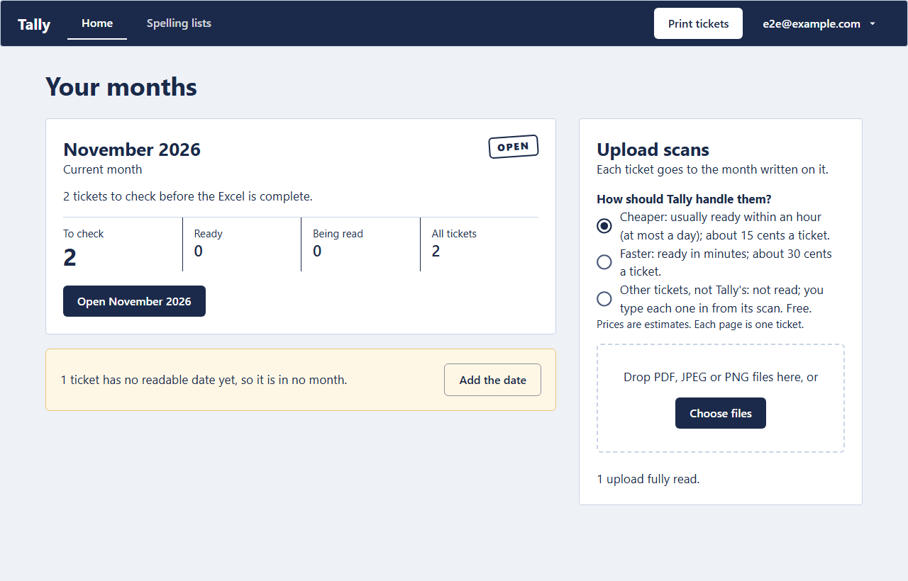
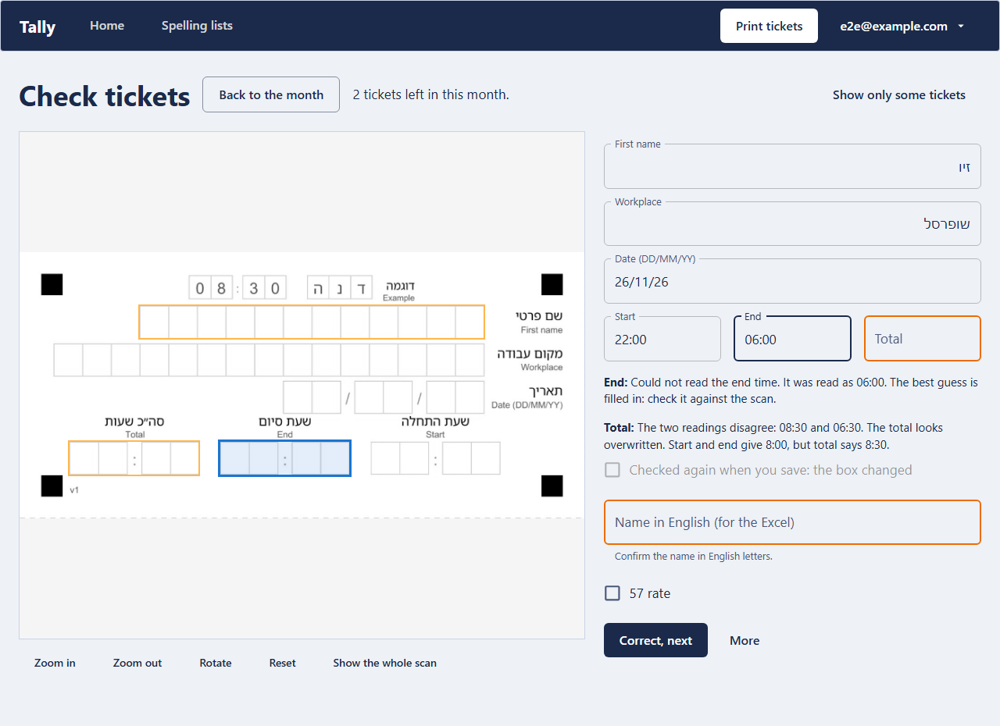

# Tally

Turns scanned paper shift tickets into an Excel file of hours per workplace, for a staffing agency. A vision model reads the handwriting, but **nothing reaches the Excel until a rule check or a person has confirmed it**.

|                                              Home                                               |                                                    Check a ticket                                                     |
| :---------------------------------------------------------------------------------------------: | :-------------------------------------------------------------------------------------------------------------------: |
|  |  |

_Screenshots use invented test data._

## The problem

A staffing agency's shift leaders fill in a paper ticket for every shift. Each month someone retypes hundreds of them into Excel, worker by worker and workplace by workplace, and the result decides what people are paid. Tally takes over the retyping, and keeps a person in charge of every number.

## How a ticket becomes a row in the Excel

1. **Upload.** Scans (PDF, JPEG or PNG) are split into one image per ticket.
2. **Straighten.** Four corner markers on the printed ticket let Tally straighten and crop each scan.
3. **Read twice.** A vision model (Claude API) reads every box twice, independently, the second time with enlarged crops. Where they disagree, a third read only suggests an answer to the reviewer; it never decides.
4. **Check.** The two readings are compared, and rules run: does end minus start equal the total, is the date plausible, is the workplace or name on the known lists, is it a possible duplicate?
5. **Review.** A person sees the scan beside what was read, with every doubtful box marked, and confirms or corrects it.
6. **Export.** One Excel (a sheet per workplace, a totals sheet) and the scans as PDFs per workplace, as proof.
7. **Close the month.** Everything is deleted except a summary. Names and hours are not kept longer than needed.

## Decisions worth a look

- **Never trust a single reading.** Two independent reads, rule checks, and a person; a value is accepted only when they agree.
- **Whole minutes, never decimals.** Durations are stored as integer minutes and never rounded, so a total cannot drift.
- **Refuse what would have to be guessed.** Hours like "7.30" (seven and a half, or 7 h 18 min?) are asked about, never interpreted.
- **A local app, not a hosted one.** It runs on one Windows laptop through Docker; the only thing that leaves it is the ticket images, sent to be read.
- **Store as little as possible.** It stores a yes/no "57 rate" tick per ticket, never a rate or an amount, and keeps no data after a month is closed.
- **Cost measured, not guessed.** About 9 cents a ticket, using the batch API and prompt caching, after checking that accuracy was unchanged.

All 70 decisions, with the reasons, are in [`docs/DECISIONS.md`](docs/DECISIONS.md).

## Also in it

- **Other tickets:** paper that isn't Tally's own can be uploaded too, is never read, and is typed in by a person next to its scan, one line per shift.
- **57 rate and morning hours:** an optional pay-rate tick per ticket and hours typed per workplace, filling their own columns in the Excel.
- **Spelling lists:** the agency's workplaces and worker names help the reader and group the results.
- **Duplicates and similar names:** possible duplicate tickets and look-alike workplace names are always asked about, never decided by the system.

## Built with

TypeScript throughout, in a pnpm monorepo: React 19, Vite and MUI on the web; NestJS, Prisma and PostgreSQL 16 on the server; pg-boss for the background queue; S3-compatible storage (MinIO locally); sharp and poppler for images; exceljs and pdf-lib for the files; Vitest and Playwright for tests; Docker and GitHub Actions for delivery. The reader sits behind a `TicketExtractor` interface, so tests use a fake one and never call the real API.

```
apps/web         React app
apps/api         NestJS API and background worker
packages/shared  Zod schemas, rule checks, ticket template
tools/poc        Command-line scripts that measured the reader's accuracy
docker, home     Compose files and the laptop install scripts
docs             Plan, decisions, progress notes
```

## Run it

You need Node 22.12+, pnpm 9, Docker, and [poppler](https://poppler.freedesktop.org/) (`pdftoppm`) on your PATH.

```sh
docker compose -f docker/compose.dev.yml up -d   # PostgreSQL and MinIO
pnpm install
cp .env.example .env                              # set DATABASE_URL, S3_* and ANTHROPIC_API_KEY
pnpm db:migrate
pnpm seed:admin                                   # asks for an email and a password
pnpm dev                                          # web, API and worker
```

```sh
pnpm lint && pnpm typecheck && pnpm test          # about 800 tests, none calls the real API
pnpm e2e                                          # one browser test of the review flow
```

Reading real tickets needs an Anthropic API key and costs money; the tests don't. To install it on a Windows laptop, see [`home/README.md`](home/README.md).

## Status, and how it was built

Built for my family's staffing business, and being prepared for its first real month. It was tested on 45 real tickets (not included here; the repository holds only invented data), and no wrong value was accepted without a flag.

I specified the product with the people who use it, made the design decisions, and reviewed and tested every change. The code was written with an AI coding assistant, Claude Code, working to the spec in [`docs/PLAN.md`](docs/PLAN.md) and the rules in [`CLAUDE.md`](CLAUDE.md). Every change went through a pull request with passing checks, and larger ones were reviewed by independent reviewer agents first. [`docs/PROGRESSION.md`](docs/PROGRESSION.md) tells the story of the build.

## Docs

- [`docs/PLAN.md`](docs/PLAN.md): the specification
- [`docs/DECISIONS.md`](docs/DECISIONS.md): every decision and why
- [`docs/PROGRESSION.md`](docs/PROGRESSION.md): what was built and what was learned
- [`docs/RUNBOOK-hosted.md`](docs/RUNBOOK-hosted.md): recovery guide for a hosted setup (shelved)
